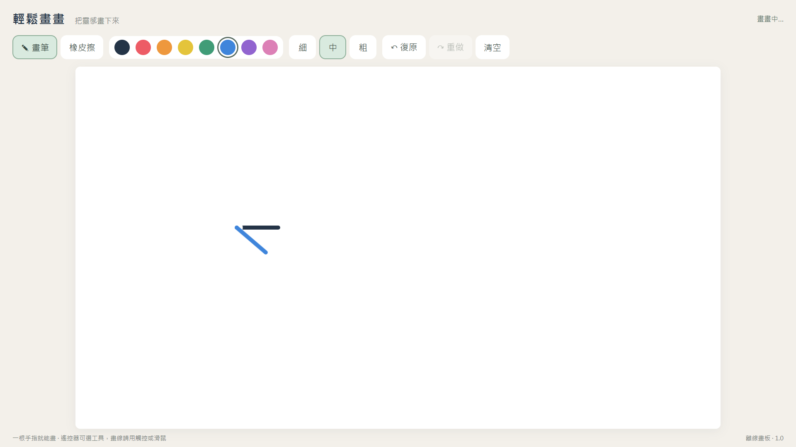

# 輕鬆畫畫 SwingSketch for webOS

[English](README.en.md)

為 LG webOS 製作的簡單離線畫板，提供繁體中文與英文兩個獨立 App。

我們想在 LG 32U889SA 上隨手畫圖，卻找不到適合的現成畫板；當時印象中這類功能似乎多與「閨蜜機」一起出現，因此決定自己製作。這是使用需求的緣起，並非宣稱只有閨蜜機才有畫板。

**由 Youplay 發想與規劃，主要程式與介面使用 OpenAI Codex 協助開發、調整、檢查及打包。** 本專案不是 LG 或 OpenAI 官方產品。



上圖為電腦瀏覽器測試畫面，並非 LG 實機截圖。

## 功能

- 八色畫筆，細、中、粗三種粗細。
- 橡皮擦、復原、重做及清空確認。
- 草稿保留於 App 的本機 localStorage，不使用網路服務、帳號、廣告或分析追蹤。
- 依可用空間調整配置，畫布維持 16:9。
- 繁中與英文 App 可並存，草稿獨立保存；沒有 App 內語言切換或草稿同步。

## 下載與安裝

從 [Releases](https://github.com/youplay/swingsketch-webos/releases) 下載 `.ipk`，不必解壓縮。

| 語言 | App 名稱 | App ID |
| --- | --- | --- |
| 繁體中文 | 輕鬆畫畫 | `org.youplay.swingsketch` |
| English | SwingSketch EN | `org.youplay.swingsketch.en` |

1. 在支援的 LG 裝置安裝官方 Developer Mode App，登入並開啟開發者模式。
2. 使用 [webOS Dev Manager](https://github.com/webosbrew/dev-manager-desktop) 配對裝置。
3. 在 Apps 選 Install，安裝下載的 IPK。
4. 從 LG 首頁開啟 App，使用裝置支援的觸控或滑鼠畫線。遙控器用於選工具，沒有觸控的電視不會因安裝 App 而具備觸控。
5. 定期於 Developer Mode 到期前續期。

[LG Developer Mode 官方說明](https://webostv.developer.lge.com/develop/getting-started/developer-mode-app)

## 限制與驗證範圍

本機草稿不是備份；移除 App、清除資料或開發者模式失效可能造成草稿遺失。重要作品請另行拍照保存。第一版無圖片匯出、圖層、壓感、防手掌誤觸、多人同畫、USB／NAS 儲存或雲端同步。

繁中版有 32U889SA 安裝紀錄；電腦端既有測試涵蓋滑鼠、模擬觸控與基本繪圖操作。英文版通過電腦瀏覽器畫線、復原重做、清空復原、草稿重載及打包檢查，尚未在 LG 實機測試。沒有完整 LG 原生觸控、旋轉及長時間草稿保存驗證，不保證所有 webOS 機型相容。

## 從原始碼打包

需要 Node.js 20 或以上及 npm：

```sh
npm ci
npm run build
```

安裝包輸出至 `dist/`。`@webos-tools/cli` 僅作建置工具，App 本體不含外部執行期程式庫。兩個語言版本的可讀原始碼分別位於 `app/zh-Hant` 與 `app/en`。

初始 Release 使用已驗證的既有 IPK。打包工具會壓縮 JavaScript，封裝中繼資料可能使重建檔案雜湊不同；Release 附下載檔案的 SHA-256，不宣稱逐位元可重現。

## 授權與來源

本專案自行製作且有權授權的程式、文件與圖示依 [MIT License](LICENSE) 提供。[第三方與素材來源](THIRD_PARTY_NOTICES.md) 列出建置工具與圖示來源。AI 輔助開發不代表對所有生成內容主張排他權利，也不取代第三方授權條件。

回報問題時請提供機型、webOS 版本、App 語言及重現步驟，避免附帳號、配對碼、金鑰或私人畫作。
